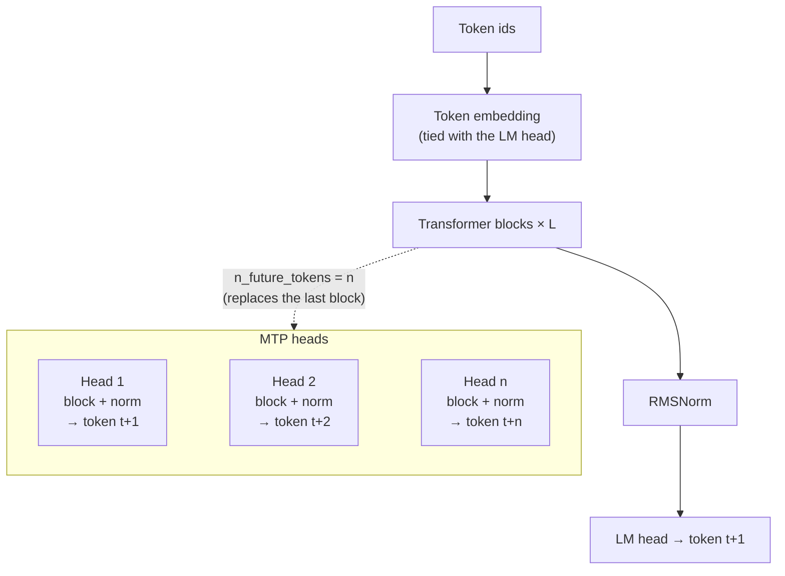
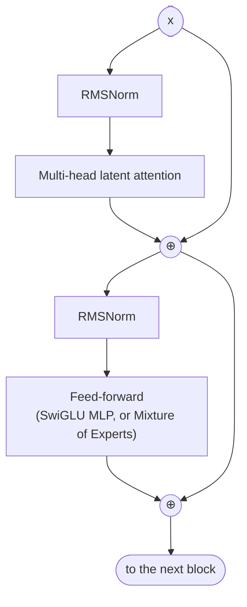
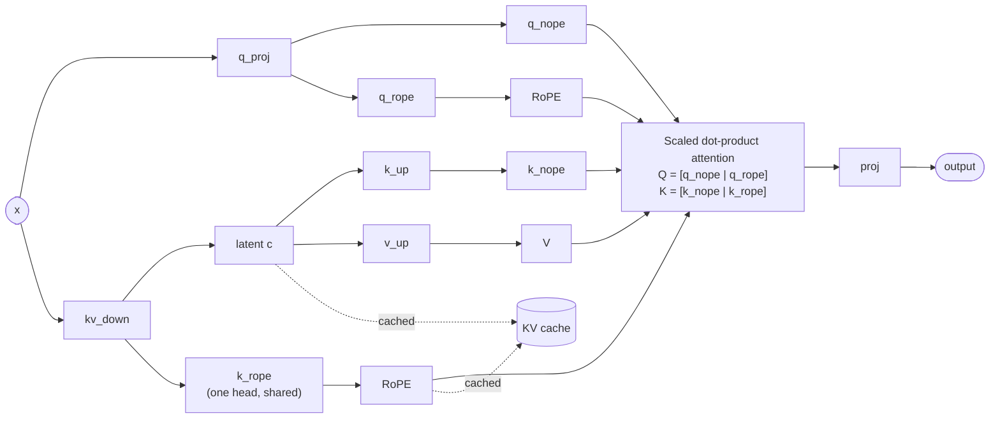
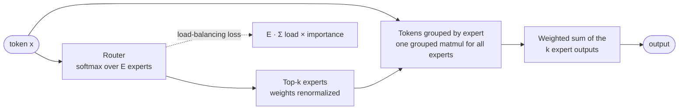

<div align="center">

# Modern LLMs

**Train a modern billion-parameter LLM from scratch, the way current frontier models are built.**

[nanoGPT](https://github.com/karpathy/nanoGPT), rebuilt on HuggingFace `PreTrainedModel` / `Trainer` / Accelerate and extended with
Multi-head Latent Attention, Mixture of Experts, the Muon optimizer, multi-token prediction and more.

[](LICENSE)
[](https://www.python.org/downloads/)
[](https://pytorch.org/)
[](https://huggingface.co/docs/transformers)
[](https://huggingface.co/docs/accelerate)

[Features](#-features) •
[Architecture](#-architecture) •
[Getting started](#-getting-started) •
[Training](#-training) •
[Inference](#-inference) •
[Roadmap](#-roadmap)

</div>

<!-- ---

## 📺 Video Lectures

> A companion video lecture series walking through the architecture, training tricks, and code — from first principles to a modern transformer.

| # | Topic | Status |
|---|-------|--------|
| 1 | Project overview & setup | 🔜 Coming soon |
| 2 | Multi-Headed Latent Attention (MLA) | 🔜 Coming soon |
| 3 | Mixture of Experts (MoE) training | 🔜 Coming soon |
| 4 | Dual optimizer (Muon + AdamW) | 🔜 Coming soon |
| 5 | Training at scale with Accelerate | 🔜 Coming soon |

📎 [Link to playlist](https://youtube.com/playlist?list=YOUR_PLAYLIST_ID) — *placeholder* -->

## ✨ Features

| | Feature | What it does |
|---|---|---|
| 🧠 | **Multi-head Latent Attention (MLA)** | K and V share a low-rank latent; the KV cache stores only the latent and one RoPE key per layer, as in DeepSeek-V2/V3 |
| 🔀 | **Mixture of Experts** | Softmax router with top-k experts, load-balancing loss, and all experts of a layer run as one grouped matmul |
| ⚡ | **Muon + AdamW** | Muon for hidden matrices (head-wise for Q/K/V) and expert weights; AdamW for embeddings, norms and routers |
| 🎯 | **Multi-token prediction** | Extra heads predict tokens t+2 … t+n during training, then act as a free draft model for self-speculative decoding |
| 🪆 | **Matryoshka nesting** | Train one model that contains smaller models (prefix slices of every weight), and extract them as standalone checkpoints |
| 🌀 | **RoPE + SwiGLU + RMSNorm** | Rotary embeddings on a dedicated slice of each head, gated SwiGLU (or GELU / squared ReLU) feed-forward, pre-norm blocks |
| 🧩 | **Scales to billions** | DDP, or ZeRO-2 via FSDP2 with pure-bf16 weights and fp32 optimizer state, plus optional activation checkpointing |
| 📈 | **Built-in evaluation** | Validation perplexity and HellaSwag accuracy during training; logs to WandB or TensorBoard |

## 🧱 Architecture

### Model overview



All MTP heads share the tied LM head. Evaluation, HellaSwag and `generate` use head 1 only, so numbers stay comparable with single-head models.

### Transformer block

Pre-norm, with a residual connection around attention and around the feed-forward layer:



With `--n-res-streams > 1`, each `⊕` is replaced by hyper-connections (mHC), which mix several residual streams with Sinkhorn–Knopp. This is implemented but off by default.

<details>
<summary><b>Multi-head latent attention, in detail</b></summary>
<br/>



- `kv_down` projects each token to a small latent (`--kv-latent-size`) plus one RoPE key (`--rope-size`). Only these two are cached, not the full per-head K and V. K and V are rebuilt from the cache with `k_up` / `v_up` at every step.
- RoPE is applied only to the `rope` slices. The single `k_rope` head is shared by all query heads.
- With a cache and several new tokens (verifying speculative drafts), attention uses an explicit bottom-right-aligned causal mask.

</details>

<details>
<summary><b>Mixture of Experts, in detail</b></summary>
<br/>



- Expert weights are stored as stacked 3-D tensors `[E, out, in]` and run with `grouped_mm` (requires bf16).
- The load-balancing loss equals 1 when routing is perfectly balanced. It is averaged over all MoE layers and added with weight `--router-loss-weight`.
- Per-expert load and importance are logged during training.
- `--n-experts=1` selects a plain dense feed-forward layer.

</details>

<details>
<summary><b>Optimizer and schedule</b></summary>
<br/>

One [muonium](https://pypi.org/project/muonium/) `Muon` optimizer with a different algorithm per parameter group, chosen by parameter name:

| Parameters | Algorithm |
|---|---|
| `q_proj`, `k_up`, `v_up` | Muon, orthogonalized per attention head |
| Other hidden 2-D weights (`kv_down`, `proj`, FFN) | Muon |
| MoE expert weights (3-D) | Muon, per expert |
| Embedding / LM head, routers, mHC, norms and other 1-D params | AdamW (weight decay only for ≥ 2-D) |

Muon momentum and AdamW moments are kept in fp32. All groups share one learning-rate schedule (linear warmup, cosine decay to 0.1×, then constant) with separate base learning rates (`--muon-lr`, `--adamw-lr`).

</details>

<details>
<summary><b>Multi-token prediction and self-speculative decoding</b></summary>
<br/>

- With `--n-future-tokens=n`, head *i* predicts token *t + i* (after [Gloeckle et al., 2024](https://arxiv.org/abs/2404.19737)). The loss is head 1's loss plus `--mtp-loss-weight` × the mean of the other heads.
- Each head runs under activation checkpointing, so only one head's `[B, T, V]` logits exist at a time.
- To make the extra heads cheaper, they can predict only the most frequent tokens (`--draft-vocab-size`) and compute their loss on a random fraction of positions (`--mtp-position-frac`). Head 1 always uses the full vocabulary and every position.
- At inference, heads 2 … n draft the next tokens and a single forward pass verifies them. Output is identical to greedy decoding.

</details>

<details>
<summary><b>Matryoshka (nested-width) training</b></summary>
<br/>

- With `--matryoshka-fracs=1,0.5,0.25`, each smaller size *f* uses the first *f* of every width: d_model, attention heads, MLA latent and FFN width, in every block including the MTP heads. RMSNorm normalizes over the prefix dims. Head and RoPE sizes are not nested.
- By default each micro-batch trains one size (the full model with probability `--matryoshka-full-prob`). `--matryoshka-full-per-step` makes every optimizer step include a full-size micro-batch, which keeps training stable.
- With `--matryoshka-all-sizes`, every micro-batch trains every size on the same tokens and the loss is their sum, so the full model sees exactly the data of a run without nesting. `--matryoshka-small-prob=p` keeps the full model on every micro-batch but adds each smaller size only with probability *p*.
- **Nested draft model.** `--mtp-nested-only` trains the extra MTP heads only at the smaller sizes, so the full model learns next-token prediction alone and a nested model with MTP heads becomes a cheap draft model.
- **Distillation.** `--matryoshka-kd-weight` adds a KL term that pulls each nested head *i* at position *t* toward the full model's next-token distribution at *t + i*. That is the prediction the full model checks the draft against, so the term directly targets draft acceptance.
- `scripts/extract_matryoshka.py` slices out a standalone smaller checkpoint whose outputs equal the parent model's at that size.

</details>

### Repository layout

```text
train.py                    Training entry point (CLI → ModelConfig → Model → LLMTrainer)
infer.py                    Generation, throughput benchmark, speculative decoding
model/
├── config.py               ModelConfig (HF PretrainedConfig)
├── model.py                Model (PreTrainedModel + GenerationMixin), MTP heads, Matryoshka extraction
├── layer.py                Block: pre-norm MLA + FFN/MoE with residual connections
├── attention.py            Multi-head latent attention with a latent KV cache
├── feed_forward.py         Dense FFN (SwiGLU / GELU / squared ReLU) and MoE
└── hyper_connections.py    mHC router (Sinkhorn–Knopp stream mixing)
utils/
├── train_utils.py          LLMTrainer: optimizer groups, LR schedule, eval, logging
├── data_utils.py           Sharded token dataset, HellaSwag dataset
├── spec_decode.py          Greedy and MTP speculative decoding (self or nested draft)
├── fast_decode.py          The same decoders with a static cache and CUDA graphs
└── misc_utils.py           Helpers
scripts/
├── token_frequencies.py    Token counts for the MTP draft vocabulary
└── extract_matryoshka.py   Save a smaller nested model as its own checkpoint
tokenizer/                  StarCoderBase tokenizer + 64 special tokens (vocab 49,216)
run.sh                      Example SLURM launch script
```

## 🚀 Getting started

**Requirements:** Python 3.12, one or more CUDA GPUs with bf16 support (developed on A100 and H200; small configs run on consumer GPUs). MoE layers need bf16.

```bash
git clone git@github.com:paragduttaiisc/modern_llms.git
cd modern_llms
python -m venv venv && source venv/bin/activate
pip install -r requirements.txt
```

**Data:** training reads `.npy` token shards listed in a JSON manifest, `{"train": [...], "val": [...]}`, with paths relative to the repository root (default `data/web_small_10B.json`). Each shard holds 20M tokens. HellaSwag evaluation reads `data/Hellaswag/hellaswag_tokenized.npy`.

## 🎯 Training

> [!TIP]
> For a quick smoke test, add `--dont-log --dont-save --dont-eval --n-iters=20 --n-layers=2` and use fewer processes.

Gradient accumulation is set automatically so each optimizer step covers about 2¹⁹ ≈ 0.5M tokens (`--effective-tokens-target`). Pass `--wandb-run-name` to log to WandB; otherwise logs go to TensorBoard.

### Dense and MoE models

```bash
# Dense GPT-2-base-sized model (~110M) with a SwiGLU MLP
accelerate launch --num_processes=8 --mixed_precision=bf16 train.py \
    --n-experts=1 --batch-size=16 --wandb-run-name="<RunName>"

# Mixture of Experts (default: 8 experts, 2 active per token)
accelerate launch --num_processes=8 --mixed_precision=bf16 train.py \
    --batch-size=8 --wandb-run-name="<RunName>"
```

### Larger models with ZeRO-2

`--fsdp` shards gradients and optimizer state across GPUs (FSDP2 `shard_grad_op`, equivalent to ZeRO-2). Each GPU still holds a full copy of the weights during a step.
- **Precision:** weights and gradients stay bf16. Mixed precision is turned off, so Accelerate doesn't upcast them to fp32; the loss and softmaxes still run in fp32.
- **Memory:** `--activation-checkpointing` recomputes each block in the backward pass to save activation memory.

Example: a GPT-3 Large-shaped MoE (24 layers, d_model 1536, 16 heads of 96) with 12 experts, 3 active per token: **2.95B total / 0.91B active parameters**.

```bash
accelerate launch --num_processes=8 train.py --fsdp \
    --embed-size=1536 --n-layers=24 --n-heads=16 --attn-head-size=96 --rope-size=32 \
    --kv-latent-size=384 --mlp-hidden-size=3072 --n-experts=12 --n-active-experts=3 \
    --batch-size=4 --shard-list-file=data/llm_mix_100B.json --wandb-run-name="<RunName>"
```

### Multi-token prediction

```bash
# 1. Count token frequencies (once per dataset) for the draft vocabulary
python scripts/token_frequencies.py --shard-list-file=data/web_small_10B.json \
    --out=data/token_counts_web_small_10B.npy

# 2. Train 4 heads; heads 2-4 predict the top 16k tokens on half the positions
accelerate launch --num_processes=8 --mixed_precision=bf16 train.py --n-experts=1 \
    --n-future-tokens=4 --draft-vocab-size=16384 --mtp-position-frac=0.5 \
    --wandb-run-name="<RunName>"
```

On a 1B-token sample of `web_small_10B`, the top 8,192 tokens cover 95.6% of all tokens and the top 16,384 cover 99.25%. Alongside the total `loss`, training logs `lm_loss` (next token), `mtp_loss` (mean of heads 2 … n) and `mtp_loss_<k>` for each head.

### Matryoshka nested models

```bash
# Train the full model and a quarter-width model on every micro-batch
accelerate launch --num_processes=8 --mixed_precision=bf16 train.py --n-experts=1 \
    --matryoshka-fracs=1,0.25 --matryoshka-all-sizes --wandb-run-name="<RunName>"

# Nested draft model: the full model always trains (next-token only); the quarter-width
# model joins half the micro-batches, with 4 MTP heads distilled toward the full model
accelerate launch --num_processes=8 --mixed_precision=bf16 train.py --n-experts=1 \
    --matryoshka-fracs=1,0.25 --matryoshka-all-sizes --matryoshka-small-prob=0.5 \
    --n-future-tokens=4 --mtp-nested-only --matryoshka-kd-weight=1.0 \
    --draft-vocab-size=16384 --mtp-position-frac=0.5 --wandb-run-name="<RunName>"

# Save the quarter-width model as its own checkpoint
python scripts/extract_matryoshka.py --save-dir=outputs/checkpoint-xxx --frac=0.25 \
    --out=outputs/checkpoint-xxx-f0.25
```

Every size must give whole-number dimensions (768·f, 12·f heads, 128·f latent, FFN width·f). Per-size metrics get an `_f<size>` suffix, e.g. `lm_loss_f0.25`, `eval_f0.25_loss` and `kd_loss_f0.25`.

### Command-line arguments

<details>
<summary><b>Model shape</b></summary>

| Argument | Default | Description |
|---|---|---|
| `--n-layers` | 12 | Transformer blocks |
| `--embed-size` | 768 | Model width (d_model) |
| `--n-heads` | 12 | Attention heads |
| `--attn-head-size` | 64 | Per-head dimension |
| `--rope-size` | 16 | RoPE part of each head |
| `--legacy-rope-positions` | off | Compute RoPE positions in the activations' dtype, as runs before the fp32 fix did (in bf16 this rounds positions above 256) |
| `--kv-latent-size` | 128 | MLA latent size |
| `--mlp-hidden-size` | 3072 | FFN width (SwiGLU uses 2/3 of it, rounded up to a multiple of 256) |
| `--non-linearity` | SwiGLU | `SwiGLU`, `GELU` or `SqReLU` |
| `--block-size` | 2048 | Context length |
| `--vocab-size` | 49216 | Must match the tokenizer |
| `--dropout` | 0.1 | Dropout rate |
| `--n-res-streams` | 1 | Residual streams for mHC (1 = plain residual) |

</details>

<details>
<summary><b>Mixture of Experts</b></summary>

| Argument | Default | Description |
|---|---|---|
| `--n-experts` | 8 | Experts per layer (**1 = dense FFN**) |
| `--n-active-experts` | 2 | Experts per token (top-k) |
| `--router-loss-weight` | 0.01 | Weight of the load-balancing loss |

</details>

<details>
<summary><b>Multi-token prediction</b></summary>

| Argument | Default | Description |
|---|---|---|
| `--n-future-tokens` | 1 | Prediction heads (1 = standard next-token model) |
| `--mtp-loss-weight` | 1.0 | Weight of the mean loss of heads 2 … n |
| `--no-mtp-checkpoint` | off | Don't checkpoint the heads (faster, more memory) |
| `--draft-vocab-size` | 0 | Heads 2 … n predict only the N most frequent tokens (0 = full vocab) |
| `--draft-vocab-file` | `data/token_counts_web_small_10B.npy` | Token counts from `scripts/token_frequencies.py` |
| `--mtp-position-frac` | 1.0 | Fraction of positions used for the loss of heads 2 … n |

</details>

<details>
<summary><b>Matryoshka</b></summary>

| Argument | Default | Description |
|---|---|---|
| `--matryoshka-fracs` | `1` | Comma-separated nested widths, e.g. `1,0.5,0.25` (1 = no nesting) |
| `--matryoshka-all-sizes` | off | Train every size on every micro-batch (loss = sum over sizes) |
| `--matryoshka-small-prob` | 1.0 | With `--matryoshka-all-sizes`: probability each smaller size joins a micro-batch (the full size always trains) |
| `--mtp-nested-only` | off | Train the extra MTP heads only at the smaller sizes (needs `--n-future-tokens > 1`) |
| `--matryoshka-kd-weight` | 0.0 | Weight of the KL distilling every head of the smaller sizes toward the full model (0 = off) |
| `--matryoshka-kd-position-frac` | 0.25 | Fraction of positions used for that KL |
| `--matryoshka-full-prob` | 0.5 | When sampling: probability a micro-batch trains the full model |
| `--matryoshka-full-per-step` | off | When sampling: every optimizer step includes a full-size micro-batch (recommended; prevents divergence) |

</details>

<details>
<summary><b>Optimization, scale and logging</b></summary>

| Argument | Default | Description |
|---|---|---|
| `--batch-size` | 16 | Sequences per GPU per micro-batch |
| `--effective-tokens-target` | 2¹⁹ | Tokens per optimizer step (sets gradient accumulation) |
| `--n-iters` | 19050 | Optimizer steps (≈ 10B tokens) |
| `--warmup-iters` / `--last-decay-iter` | 200 / 17150 | End of warmup / end of cosine decay |
| `--muon-lr` / `--adamw-lr` | 0.02 / 1e-3 | Base learning rates |
| `--muon-weight-decay` / `--adamw-weight-decay` | 0.01 / 0.1 | Weight decay |
| `--betas` / `--optimizer-epsilon` | 0.9 0.95 / 1e-8 | AdamW betas and epsilon |
| `--max-grad-norm` | 1.0 | Gradient clipping |
| `--fsdp` | off | ZeRO-2 via FSDP2 (pure-bf16 weights and gradients) |
| `--activation-checkpointing` | off | Recompute each block in backward |
| `--shard-list-file` | `data/web_small_10B.json` | Data manifest |
| `--eval-interval` / `--save-interval` | 500 / 5000 | Steps between evals / checkpoints |
| `--resume-training` | off | Resume from the latest checkpoint in `--save-dir` |
| `--wandb-run-name` | — | Log to WandB under this name |
| `--dont-log` / `--dont-save` / `--dont-eval` | off | Disable logging / checkpoints / evaluation |

</details>

## 🔍 Inference

```bash
# Sample with a KV cache (reports throughput)
python infer.py --save-dir=outputs/checkpoint-xxx --prompt "Hello" --use-cache \
    --max-new-tokens=256 --temperature=0.9 --num-return-sequences=3

# MTP checkpoints: greedy vs. self-speculative decoding
# (reports tokens per forward pass, draft acceptance and speedup)
python infer.py --save-dir=outputs/checkpoint-xxx --prompt "Hello" --speculative --max-new-tokens=256
```

Add `--cuda-graphs` to `--speculative` to decode with a static KV cache and CUDA graphs (`utils/fast_decode.py`). At batch size 1 most of the time otherwise goes to launching kernels from Python. On an A100 with a 124M MTP4 checkpoint, greedy decoding went from 64 to 394 tok/s, and self-speculative decoding reached 534 tok/s, with the same output as eager decoding (exact in fp32). It supports dense models; MoE layers can't be captured on GPUs where `grouped_mm` syncs with the CPU, such as A100 and RTX 30xx.

Add `--matryoshka-frac=0.25` to run a smaller nested size of a Matryoshka checkpoint (this also works with `--speculative`). For a checkpoint trained with `--mtp-nested-only`, `--speculative --draft-frac=0.25` drafts with the quarter-width model's MTP heads and verifies with the full model, so the output still equals the full model's greedy decoding.

## 📊 Evaluation and logging

At every eval interval, the trainer reports:

- **Validation loss and perplexity**, for the full model and each Matryoshka size.
- **HellaSwag accuracy**: the correct ending must have the lowest per-token loss of the 4 candidates.

Training logs the total loss and its parts (`lm_loss`, `mtp_loss`, `router_loss`), perplexity, tokens/sec, learning rate per optimizer, and per-expert load and importance.

## 🧭 Roadmap

<details open>
<summary><b>✅ Done</b></summary>
<br/>

- [x] Character-level bigram model → GPT-2 architecture (nanoGPT)
- [x] HuggingFace model classes (`PreTrainedModel` + `GenerationMixin`) with beam search and repetition penalty
- [x] Accelerate + HuggingFace `Trainer`: multi-GPU DDP, bf16, gradient accumulation
- [x] WandB and TensorBoard logging
- [x] Flash attention (`F.scaled_dot_product_attention`)
- [x] StarCoderBase tokenizer with custom special tokens
- [x] 100B-token dataset (FineWeb-Edu, RedPajama-GitHub, Cosmopedia, OpenWebMath) in sharded `IterableDataset` form
- [x] Muon (hidden matrices) + AdamW (everything else) in one optimizer
- [x] Warmup → cosine decay → constant learning-rate schedule
- [x] Weight initialization, RoPE, KV cache, RMSNorm
- [x] SwiGLU and squared-ReLU feed-forward layers
- [x] HellaSwag evaluation
- [x] Multi-head latent attention (MLA) with DeepSeek-style decoupled RoPE
- [x] Mixture of Experts with top-k routing and load-balancing loss (`--n-experts=1` for dense)
- [x] Hyper-connections (mHC) with Sinkhorn–Knopp stream mixing
- [x] Multi-token prediction with self-speculative decoding
- [x] Matryoshka nested-width training with extraction of smaller models
- [x] ZeRO-2 (FSDP2) with pure-bf16 weights, fp32 optimizer state and activation checkpointing

</details>

<details open>
<summary><b>🚧 Planned</b></summary>
<br/>

- [ ] **Sparse attention via token clustering**: attend to cluster centroids of groups of tokens, reducing attention from O(T²) to O(T·C).
- [ ] **Hybrid SSM / linear-attention layers**: replace most attention layers with Gated DeltaNet or Mamba-2 layers and keep about 1 MLA layer in 4, as in Qwen3-Next, Kimi Linear and Nemotron-H.
  - Each linear layer keeps a fixed-size state instead of a per-token KV cache, so decoding costs the same per token at any context length; past ~1k tokens the state is smaller than MLA's cache.
  - Needs long-context training (16k+) to show the benefit.
  - Speculative decoding must save and restore recurrent states instead of cropping the cache.
- [ ] **Looped (recurrent-depth) transformers**: reuse a block several times per token, with the number of loops chosen at inference:
  - more loops for hard problems,
  - early exit for easy tokens,
  - few-loop drafts verified by full loops for self-speculative decoding.
- [ ] **Engrams**: a learnable external key-value memory for retrieval beyond the context window.
- [ ] **Supervised fine-tuning (SFT)**: instruction-following with prompt templates.
- [ ] **Preference optimization**: RLHF / DPO / GRPO.
- [ ] **LoRA**: low-rank adapters for efficient fine-tuning.
- [ ] **RAG**: retrieval from a vector database.
- [ ] **vLLM serving**: PagedAttention and continuous batching.
- [ ] **Quantization**: INT8 / INT4 / GGUF for consumer GPUs.

</details>

<!-- ---

## 📚 Paper References

Techniques used in this project, with links to the original papers:

| Technique | Paper |
|-----------|-------|
| **Multi-Headed Latent Attention (MLA)** | [DeepSeek-V3 Technical Report](https://arxiv.org/abs/2412.19437) |
| **Mixture of Experts (MoE)** | [Mixtral of Experts](https://arxiv.org/abs/2401.04088) |
| **Muon Optimizer** | [Muon: Momentum Orthogonalized NeuralOptimizer](https://arxiv.org/abs/2411.02884) |
| **Flash Attention** | [FlashAttention: Fast and Memory-Efficient Exact Attention](https://arxiv.org/abs/2205.14135) |
| **Rotary Positional Embeddings (RoPE)** | [RoFormer: Enhanced Transformer with Rotary Position Embedding](https://arxiv.org/abs/2104.09864) |
| **Gated Linear Units (GLU)** | [Language Models are Few-Shot Learners (GPT-3)](https://arxiv.org/abs/2005.14165) |
| **SwiGLU Activation** | [GLU Variants Improve Transformer](https://arxiv.org/abs/2105.09118) |
| **RMSNorm** | [Root Mean Layer Normalization](https://arxiv.org/abs/1910.07467) |
| **nanoGPT** | [nanoGPT — The simplest best tutorial/training codebase for training LLMs](https://github.com/karpathy/nanoGPT) |

--- -->

## 📝 License

Released under [CC0-1.0](LICENSE) (public domain dedication).

<div align="center">
<sub>Built for learning, inspired by <a href="https://github.com/karpathy/nanoGPT">nanoGPT</a>.</sub>
</div>
